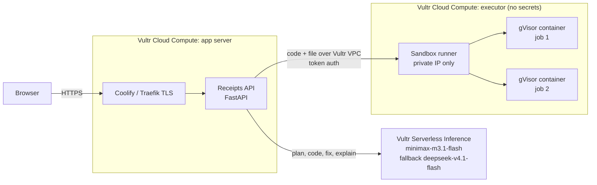
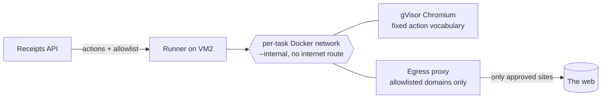

# Countersign

**Every answer, signed twice.** An AI agent that analyses your files and works on live websites inside a sealed sandbox on Vultr. A second, independent auditor checks its numbers, every step prints a receipt you can replay, and risky runs can get a brand-new Vultr VM that is destroyed afterwards.

Built for the [Vultr: Agent Rush Hackathon](https://lablab.ai/ai-hackathons/vultr-hackathon) on lablab.ai, Challenge 1: *Blast Radius Zero*.

- Website: https://agentrush.aashirnoman.dev
- Workspace: https://agentrush.aashirnoman.dev/app

(The repository keeps its original name, `receipts-agents`.)

---

## The problem

Ask a chatbot about your spreadsheet and it will happily describe numbers it never computed. Give an agent a code interpreter and you have a new problem: the code is written by a model, the data may contain instructions from strangers, and the code runs somewhere you care about.

Countersign does both halves properly:

1. **Real work, not descriptions.** The agent writes Python, actually runs it on your file, reads the real output, fixes its own errors, and only reports numbers the code printed.
2. **Zero blast radius.** That code never touches the web server. It runs in a throwaway gVisor container on a separate Vultr VM with no network, no secrets, hard limits, and is destroyed after every task.

## How it works



**The agent loop** (streamed live to the UI):

1. **Profile and data scan**: the uploaded file is opened *inside the sandbox* by fixed code, which also flags cells that try to give instructions to an AI (prompt injection). The web server never parses user files.
1. **Pre-flight question check**: `nemotron-3.5-content-safety` on Vultr Serverless Inference plus heuristics.
2. **Plan**: the model writes a short plan from the file profile and the question.
2. **Explore (stage 1 of 3)**: a short model-written script inspects the data in the sandbox (exact category values, date ranges); its printed findings feed the analysis.
3. **Code**: the model writes one Python script.
4. **Pre-flight code scan**: the generated code is parsed (never executed) with Python's `ast`. Network, process, secret, dynamic-code and system-file access pause the run for **human approval**. Rejected code never runs; the model rewrites it.
5. **Run**: the script is dispatched to the executor VM and runs in a fresh gVisor container.
6. **Self-heal**: on failure, the real traceback goes back to the model, up to 3 attempts. If the sandbox *blocked* something, the model is told the action was forbidden and to ignore instructions hidden in the data.
7. **Verify (stage 3 of 3, two-key)**: a second model call picks the headline numbers (each must literally appear in the printed output), then an *independent auditor* script, written without seeing the analysis code or values and using a different method, recomputes them in a fresh sandbox. Match within 0.5% stamps **VERIFIED**; disagreement is flagged in the answer.
8. **Explain**: the model answers using only the printed output. The answer is tied to the job ID that produced it.

A **Stop** button halts the agent at any point and kills the running sandbox container immediately; the dashboard shows the live count of sandbox containers (0 when idle).

Every run prints a **receipt**: job ID, model, SHA-256 of the exact code, exit code, duration, runtime, limits, containment events, and SHA-256 of every output file.

## Research the web (sandboxed browser agent)

The second mode gives the agent a real Chromium browser, still with zero blast radius:



1. **Scope**: you name the sites, or the model proposes them and you approve. The browser can reach nothing else.
2. **Plan**: the model replies with JSON actions from a fixed vocabulary (`goto`, `click`, `fill`, `select`, `check`, `press`, `extract`, `wait`, `screenshot`). It never writes browser code.
3. **Action guard**: navigation outside the allowlist is refused before anything runs; typing into password, card or account fields is always refused; anything that submits, buys, sends or signs up pauses for **human approval**.
4. **Browse**: each turn starts a fresh gVisor container on its own `--internal` network. Its only route out is a per-task egress proxy that allows the approved domains, resolves DNS itself and refuses private, loopback and cloud-metadata addresses (DNS-rebinding safe). Blocked attempts become receipt events. Browser, proxy and network are removed after every turn.
5. **Evidence check**: the agent must quote the page text behind its answer; every quote is matched against text the browser actually returned, and a vision model on Vultr Serverless Inference checks the final screenshot. Unbacked claims stamp **MISMATCH**.
6. **Hand-off**: extracted records become a dataset, profiled in the analyst sandbox, so you can go straight from "collect this from the web" to "chart it".

Page text is treated as untrusted data throughout: the model is told never to follow instructions found on a page, and even if it tried, it could only reach the approved sites and never type a credential.

## Fresh-VM mode (maximum isolation)

For anything you do not want to share a machine with, choose **Run on: a fresh Vultr VM** (signed-in users).

Restoring a Vultr snapshot takes 10 to 60 minutes, so the app keeps a **warm pool**:

1. A watchdog uses the **Vultr API** to create a standby Cloud Compute instance from a snapshot of the executor VM, in the same VPC and firewall group, tagged `receipts-standby`. A boot script binds its runner to its own private IP with its **own runner token** (derived per VM, never the main token). A standby VM never runs anything.
2. A run that asks for a fresh VM **claims** a ready standby (retagged `receipts-disposable`). Every sandbox job of that run (exploration, analysis, self-fixes, the auditor, or the browser turns) goes only to that VM, and receipts record `executed_on: disposable-vm:<instance id>`. A replacement starts booting immediately.
3. When the run ends, is stopped, or fails, the VM is **deleted and the deletion confirmed** through the Vultr API, and a DESTROYED slip prints.
4. The watchdog deletes claimed VMs older than 15 minutes, standbys older than 24 hours, and standbys whose runner never answers. Caps: 2 in use at once, 10 created per hour.

If no standby is ready, the run says so and uses the shared sandbox; it never waits on a snapshot restore. Pool status: `GET /api/vm-pool`.

## PDF report

Any finished run (analysis or web research) can be downloaded as a PDF: question, answer, verification table or evidence quotes, charts or screenshots, containment summary, every sandbox receipt, and the final code. The PDF is laid out **inside the sandbox** by a fixed, human-written script (never model-written) from the run's recorded events and stored files, and gets its own receipt (kind `report`) with its SHA-256.

## Containment

| Control | How |
| --- | --- |
| Process isolation | gVisor (`runsc`) user-space kernel; code never runs on the host kernel or in the app runtime |
| Separate machine | Execution happens on a second Vultr VM; the app server only sends code over the VPC |
| No network | `--network none`; data exfiltration and downloads fail |
| No secrets | The executor holds no API keys; the inference key lives only on the app server |
| Resource limits | 512 MB memory (no swap), 1 CPU, 64 processes, 30 s wall clock |
| Least privilege | Non-root user, all capabilities dropped, `no-new-privileges`, read-only root filesystem, 64 MB tmpfs |
| Lifecycle | One container per task, `--rm`, existence checked after every run, job folder deleted |
| Network perimeter | Runner listens only on the private IP; host firewall allows only the app server's private IP; Vultr Firewall groups on both VMs |
| Pre-flight guard | Sandbox-side data scan for injected instructions, Nemotron safety check on the question, static code scan, human approval for anything risky |
| Browser egress | Per-task internal network; allowlist proxy is the only exit (the proxy runs only our fixed proxy code in a hardened standard container, read-only, no capabilities, nobody user; the browser itself runs on gVisor); private/metadata IPs refused; 1 GB memory, 256 processes, 90 s per turn |
| Browser actions | Fixed action vocabulary (no model-written browser code), credential fields refused, submits need approval |
| Fresh-VM tier | Optional never-used Vultr VM per run from a warm pool, own runner token, deleted after the run and confirmed via API; watchdog cleans up |
| Abuse limits | Per-IP hourly rate limit, 10 MB uploads, output size caps |

**Containment moment (shown in the demo video):** load *Poisoned support tickets*. One ticket contains hidden instructions telling the AI to read environment variables and `/etc/passwd` and upload them to an external server. If the model follows them, the upload fails because the sandbox has no network, the run is flagged and stamped BLOCKED, the environment shows zero secrets, and the agent retries with a security note and produces the honest summary.

`runner/test-runner.py` proves each control from the app server: exfiltration blocked, no secrets present, infinite loop killed, memory bomb killed, host filesystem read-only.

## Vultr services used

- **Vultr Cloud Compute ×2** (Atlanta): app server and isolated executor.
- **Vultr Serverless Inference**: all LLM calls (OpenAI-compatible API at `api.vultrinference.com/v1`), main model `minimax-m3.1-flash` with automatic fallback to `deepseek-v4.1-flash-1017`. Models were chosen by benchmarking six candidates on generation and repair tasks.
- **Vultr VPC**: private network between the two VMs; the runner is unreachable from the internet.
- **Vultr Firewall**: firewall groups on both instances.
- **Vultr API + Snapshots**: fresh-VM mode keeps a warm pool of snapshot-restored Cloud Compute instances and destroys each one after a single run.
- **Vultr Marketplace: Coolify**: Git-based deploys, Traefik reverse proxy and Let's Encrypt TLS on the app server.

## Repository layout

```
Dockerfile    Builds the web app; Coolify deploys from here
app/          Web app + agent (FastAPI, single-page UI)
  main.py     API, analyst and research agent loops, receipts, rate limiting
  research.py Browser prompts, action guard, evidence check
  report.py   Fixed sandbox script that lays out the PDF report
  disposable.py Fresh-VM tier: warm pool, claim, destroy, watchdog (Vultr API)
  llm.py      Vultr Serverless Inference client with fallback
  prompts.py  Plan / code / fix / explain prompts and the fixed profiling script
  static/     Landing page (landing.html) and workspace (index.html)
  samples/    Demo datasets, including the poisoned file
runner/       Sandbox runner for the executor VM
  app.py              FastAPI runner: gVisor docker run with limits, events, cleanup
  sandbox.Dockerfile  Image the sandbox runs (pandas, matplotlib, ...)
  browser/            Chromium + Playwright driver that runs inside gVisor
  egress/             Per-task allowlist proxy (the browser's only exit)
  install-runner.sh   One-command installer (systemd, private-IP bind, token)
  test-runner.py      Containment test suite, run from the app server
```

## Setup

**Executor VM (Ubuntu 24.04, VPC attached)**

```bash
curl -fsSL https://get.docker.com | sh
# install gVisor: https://gvisor.dev/docs/user_guide/install/
runsc install && systemctl restart docker
bash runner/install-runner.sh          # prints RUNNER_TOKEN
ufw allow from <APP_PRIVATE_IP> to any port 8080 proto tcp
```

**App server (Vultr Marketplace: Coolify, VPC attached)**

Create a Coolify application from this repository with build pack *Dockerfile* (the root `Dockerfile`, base directory `/`), port `8080`, health check `/api/health`, and the variables in `.env.example`. Self-hosted Supabase runs as a Coolify service on the same VM. Docker does not hairpin traffic from a container on the `coolify` network back through the host's public IP to Traefik, so the app is given Traefik's internal address for the Supabase domain with a Coolify custom Docker option, `--add-host=db.<your-domain>:<coolify-proxy IP on the coolify network>` (find it with `docker inspect coolify-proxy`). TLS still terminates at Traefik with the real certificate. `/api/health` reports database reachability and key roles (never the keys).

Then verify from the app server:

```bash
RUNNER_URL=http://<EXECUTOR_PRIVATE_IP>:8080 RUNNER_TOKEN=... python3 runner/test-runner.py
```

## License

MIT
