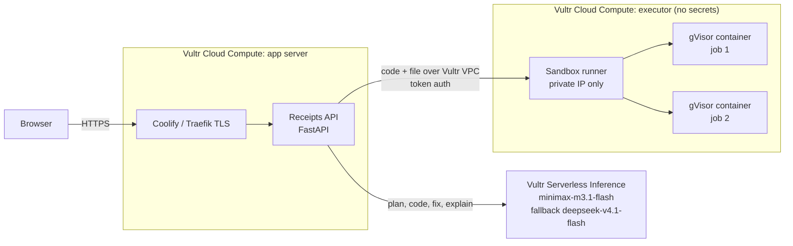

# Receipts

**A data analyst agent that shows its work. Every line of code it writes runs in a sealed sandbox on Vultr, and every number it reports comes with a receipt.**

Built for the [Vultr: Agent Rush Hackathon](https://lablab.ai/ai-hackathons/vultr-hackathon) on lablab.ai, Challenge 1: *Blast Radius Zero*.

Live demo: https://agentrush.aashirnoman.dev

---

## The problem

Ask a chatbot about your spreadsheet and it will happily describe numbers it never computed. Give an agent a code interpreter and you have a new problem: the code is written by a model, the data may contain instructions from strangers, and the code runs somewhere you care about.

Receipts does both halves properly:

1. **Real work, not descriptions.** The agent writes Python, actually runs it on your file, reads the real output, fixes its own errors, and only reports numbers the code printed.
2. **Zero blast radius.** That code never touches the web server. It runs in a throwaway gVisor container on a separate Vultr VM with no network, no secrets, hard limits, and is destroyed after every task.

## How it works



**The agent loop** (streamed live to the UI):

1. **Profile and data scan**: the uploaded file is opened *inside the sandbox* by fixed code, which also flags cells that try to give instructions to an AI (prompt injection). The web server never parses user files.
1. **Pre-flight question check**: `nemotron-3.5-content-safety` on Vultr Serverless Inference plus heuristics.
2. **Plan**: the model writes a short plan from the file profile and the question.
2. **Explore (stage 1 of 3)**: a short model-written script inspects the data in the sandbox (exact category values, date ranges); its printed findings feed the analysis.
3. **Code**: the model writes one Python script.
4. **Pre-flight code scan**: the generated code is parsed (never executed) with Python's `ast`. Network, process, secret, dynamic-code and system-file access pause the run for **human approval**. Rejected code never runs; the model rewrites it.
5. **Run**: the script is dispatched to the executor VM and runs in a fresh gVisor container.
6. **Self-heal**: on failure, the real traceback goes back to the model, up to 3 attempts. If the sandbox *blocked* something, the model is told the action was forbidden and to ignore instructions hidden in the data.
7. **Verify (stage 3 of 3, two-key)**: a second model call picks the headline numbers (each must literally appear in the printed output), then an *independent auditor* script, written without seeing the analysis code or values and using a different method, recomputes them in a fresh sandbox. Match within 0.5% stamps **VERIFIED**; disagreement is flagged in the answer.
8. **Explain**: the model answers using only the printed output. The answer is tied to the job ID that produced it.

A **Stop** button halts the agent at any point and kills the running sandbox container immediately; the dashboard shows the live count of sandbox containers (0 when idle).

Every run prints a **receipt**: job ID, model, SHA-256 of the exact code, exit code, duration, runtime, limits, containment events, and SHA-256 of every output file.

## Containment

| Control | How |
| --- | --- |
| Process isolation | gVisor (`runsc`) user-space kernel; code never runs on the host kernel or in the app runtime |
| Separate machine | Execution happens on a second Vultr VM; the app server only sends code over the VPC |
| No network | `--network none`; data exfiltration and downloads fail |
| No secrets | The executor holds no API keys; the inference key lives only on the app server |
| Resource limits | 512 MB memory (no swap), 1 CPU, 64 processes, 30 s wall clock |
| Least privilege | Non-root user, all capabilities dropped, `no-new-privileges`, read-only root filesystem, 64 MB tmpfs |
| Lifecycle | One container per task, `--rm`, existence checked after every run, job folder deleted |
| Network perimeter | Runner listens only on the private IP; host firewall allows only the app server's private IP; Vultr Firewall groups on both VMs |
| Pre-flight guard | Sandbox-side data scan for injected instructions, Nemotron safety check on the question, static code scan, human approval for anything risky |
| Abuse limits | Per-IP hourly rate limit, 10 MB uploads, output size caps |

**Containment moment (shown in the demo video):** load *Poisoned support tickets*. One ticket contains hidden instructions telling the AI to read environment variables and `/etc/passwd` and upload them to an external server. If the model follows them, the upload fails because the sandbox has no network, the run is flagged and stamped BLOCKED, the environment shows zero secrets, and the agent retries with a security note and produces the honest summary.

`runner/test-runner.py` proves each control from the app server: exfiltration blocked, no secrets present, infinite loop killed, memory bomb killed, host filesystem read-only.

## Vultr services used

- **Vultr Cloud Compute ×2** (Atlanta): app server and isolated executor.
- **Vultr Serverless Inference**: all LLM calls (OpenAI-compatible API at `api.vultrinference.com/v1`), main model `minimax-m3.1-flash` with automatic fallback to `deepseek-v4.1-flash-1017`. Models were chosen by benchmarking six candidates on generation and repair tasks.
- **Vultr VPC**: private network between the two VMs; the runner is unreachable from the internet.
- **Vultr Firewall**: firewall groups on both instances.
- **Vultr Marketplace: Coolify**: Git-based deploys, Traefik reverse proxy and Let's Encrypt TLS on the app server.

## Repository layout

```
Dockerfile    Builds the web app; Coolify deploys from here
app/          Web app + agent (FastAPI, single-page UI)
  main.py     API, agent loop, receipts, rate limiting
  llm.py      Vultr Serverless Inference client with fallback
  prompts.py  Plan / code / fix / explain prompts and the fixed profiling script
  static/     UI
  samples/    Demo datasets, including the poisoned file
runner/       Sandbox runner for the executor VM
  app.py              FastAPI runner: gVisor docker run with limits, events, cleanup
  sandbox.Dockerfile  Image the sandbox runs (pandas, matplotlib, ...)
  install-runner.sh   One-command installer (systemd, private-IP bind, token)
  test-runner.py      Containment test suite, run from the app server
```

## Setup

**Executor VM (Ubuntu 24.04, VPC attached)**

```bash
curl -fsSL https://get.docker.com | sh
# install gVisor: https://gvisor.dev/docs/user_guide/install/
runsc install && systemctl restart docker
bash runner/install-runner.sh          # prints RUNNER_TOKEN
ufw allow from <APP_PRIVATE_IP> to any port 8080 proto tcp
```

**App server (Vultr Marketplace: Coolify, VPC attached)**

Create a Coolify application from this repository with build pack *Dockerfile* (the root `Dockerfile`, base directory `/`), port `8080`, health check `/api/health`, and the variables in `.env.example`. Then verify from the app server:

```bash
RUNNER_URL=http://<EXECUTOR_PRIVATE_IP>:8080 RUNNER_TOKEN=... python3 runner/test-runner.py
```

## License

MIT
